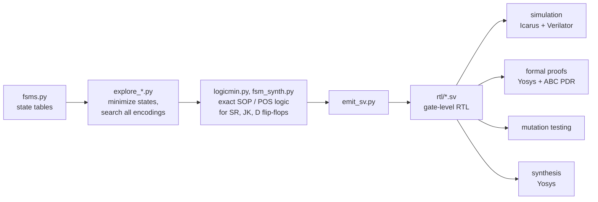

# Gate-level state machines, generated and formally verified

[](https://github.com/r800360/fsm-design-sv/actions/workflows/ci.yml)
[](LICENSE)

State machines are written once in Python. Scripts minimize them, search **every** state encoding, and compute
**exact minimum two-level logic** for SR, JK or D flip-flops. A generator then emits gate-level SystemVerilog.

Every design is checked three independent ways:
* self-checking simulation against independent reference models;
* **unbounded formal proofs**;
* **mutation testing** that measures how good the testbenches are.



## Designs

| Design | Result |
|---|---|
| Booth multiplier whose controller skips needless add/subtract cycles, Mealy and Moore versions | latency N + k + 2, where k is the number of non-zero Booth digits: 15–28 cycles for 13 bits, 21.5 on average, against a fixed 27 |
| Composite 101 / 011 sequence detector | 10-state product machine minimized to 8 states; 9 gates with SR flip-flops and 7 with JK, the best of all 840 encodings |
| Vending machine that pays change from a counted till | smallest safe till (30 one-unit bills) found by exhaustive search; slot-lock rules proven sufficient and necessary |
| Flip-flop conversions | SR → D, JK → PT, PT → SR in 0, 1 and 1 gates |

## Highlights

* **The RTL cannot drift from the analysis.** The controllers and detectors are generated from the exact
  minimization, and `make check-rtl` fails if the committed RTL differs from what the generator emits.
* **Unbounded proofs (ABC PDR):**
  * the detectors equal their specification;
  * the multiplier returns `a × b` with its exact latency, for every operand pair (N = 4 and 6);
  * the vending till never runs short, whatever customers do.
* **Proof engineering.** Stated alone, the till properties timed out after 30 minutes. Five hand-derived inductive
  invariants (value conservation, payable change, …) cut that to **29 s, 49 s and about 10 minutes**.
* **Negative controls.** A 29-bill till, narrower counters and broken RTL must all produce counterexamples, and they
  do. So the proofs are not vacuous.
* **Testbench strength.** 21 mutants (wrong gates, weakened locks, missing sign extension, …) are all caught by the
  testbenches.

## Reproduce

Every result comes from a pinned toolchain: Ubuntu 26.04 with Icarus Verilog 12.0, Verilator 5.032, Yosys 0.52 and
Z3 4.13 (see [`scripts/install-tools.sh`](scripts/install-tools.sh)).

```bash
docker build -t fsm-design-sv .
docker run --rm -u "$(id -u):$(id -g)" -v "$PWD":/work fsm-design-sv make ci     # quick suite, ~10 min
docker run --rm -u "$(id -u):$(id -g)" -v "$PWD":/work fsm-design-sv make full   # everything, ~1 h
```

Results land in `build/`, and `build/SUMMARY.md` collects them. On a machine that already has the tools,
`make <target>` works directly:

| Target | What it runs |
|---|---|
| `check-rtl` / `rtl` | check / regenerate the gate-level RTL from `scripts/fsms.py` |
| `lint`, `sim` | Verilator lint; every testbench in Icarus and Verilator |
| `exhaustive` | all 2²⁶ products of the 13-bit multiplier, both controllers |
| `formal`, `formal-quick` | the whole proof campaign, or everything except the two slowest groups |
| `mutants`, `synth`, `explore` | mutation score; Yosys gate counts and netlists; re-run the encoding searches |

**CI.** The *CI* workflow runs `make ci` on every push and uploads `build/` as an artifact. *Full verification* runs
`make full` on demand or for a `v*` tag. For a tag it also publishes a release with every output attached.

## Repository map

```
rtl/       designs; booth_ctrl_*, seq_detector_*, vending_fsm, change_serializer are generated
tb/        self-checking testbenches and tb_common.svh (checks, summary, portable PRNG)
formal/    proof harnesses, pdr.sh (one proof), run_formal.sh (campaign with expected outcomes)
scripts/   FSM models, minimizer, encoding searches, RTL generator, run/synthesis/mutation scripts
docs/      DESIGN.md (how each design works), VERIFICATION.md (every check, tool invocations)
```

Origin: these designs began as assignments in a university digital-design course. This repository is an
independent SystemVerilog re-implementation, with its own design automation and verification.

MIT License, © 2026 Rohan Sachdeva.
