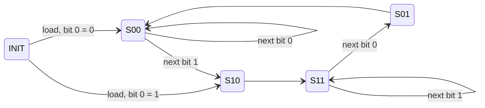

# Design

How each design works, and how the design flow derives its logic. For the checks, see [VERIFICATION.md](VERIFICATION.md).

## The flow

| Step | Script | What it does |
|---|---|---|
| specify | `scripts/fsms.py` | every state machine as a next-state / output table with don't-cares, plus the chosen encodings |
| explore | `scripts/explore_*.py` | partition-refinement state minimization; scores and synthesizes every encoding (logs: `make explore`) |
| minimize | `scripts/logicmin.py` | exact two-level minimization (SOP or POS) with don't-cares, costed in two-input gates |
| excite | `scripts/fsm_synth.py` | turns next-state tables into SR / JK / D excitation K-maps |
| emit | `scripts/emit_sv.py` | writes the gate-level RTL (`make rtl`); `make check-rtl` fails if `rtl/` differs |
| bound | `scripts/vending_bounds.py` | breadth-first search over every customer behavior of the vending till |

**Cost model.** The unit is a two-input AND/OR gate:
* Q and Q' are both available, so complemented state bits cost nothing.
* A term with k literals costs k − 1 gates, and m terms cost another m − 1.
* Terms shared between functions are counted once in the "shared" figures of the logs.

Resets are synchronous and sit in front of the flip-flops (`S & ~rst`, `R | rst`), outside the counts.

## Booth multiplier with a skipping controller (`rtl/booth_skip_mult.sv`)

The datapath has an accumulator A (N + 1 bits, one guard bit), the multiplier Q, the multiplicand M and a shift
counter. The controller's `ex_op` selects one of four operations:
* load;
* A += M;
* A −= M;
* an arithmetic shift of {A, Q}.

After N shifts the datapath freezes and `done` rises. Thanks to the guard bit, the product is exact for every pair,
including (−2^(N−1))².

A fixed-sequence controller spends an add/subtract cycle on every bit. This one spends it only when the Booth pair
`(q_i, q_(i−1))` is 01 or 10. The latency is therefore N + k + 2, where k is the number of non-zero Booth digits:
15–28 cycles for N = 13, and 21.5 on average over all multipliers.

**Mealy controller** (`booth_ctrl_mealy.sv`). It has 4 states: INIT, A = "last bit 0", B = "last bit 1", and END.
* The four window states of the textbook machine merge into A and B. The pair that caused an add or subtract causes
  the shift on the next cycle.
* All six encodings with INIT = 00 (the power-on state) were synthesized. The chosen one is minimum-bit-change and
  costs 6 + 5 gates in POS:

```
S1 = Q0 (X + C)    R1 = Q0 X' C'    S0 = Q1' Q0'    R0 = Q0 C            X = multiplier LSB, C = done shifting
EX1 = Q0 (Q1' + X)    EX0 = Q0 (Q1 + X')    DONE = Q1 Q0'                 EX: 00 load, 01 add, 10 subtract, 11 shift
```

**Moore controller** (`booth_ctrl_moore.sv`). It has 6 states, with separate states for add/subtract and for shift.
* All 2520 encodings with INIT = 000 were synthesized. The optimum costs 10 + 6 gates, and its core states still
  form a Gray cycle.
* INIT must choose between S00 and S10 on the same edge that loads Q. So it reads bit 0 of the value being loaded
  (`q_d[0]`), not Q.



S00 and S11 shift. S01 adds and S10 subtracts, each followed by a shift state. From any of the four core states, the
controller moves to END (not drawn) as soon as N shifts are done.

## Composite sequence detector (`rtl/seq_detector_sr.sv`, `seq_detector_jk.sv`)

The base machine detects 101 on z1 and 011 on z2, both overlapping. In the composite machine:
* once z2 fires, only z1 is reported;
* once z1 then fires, both are reported again.

| Step | Result |
|---|---|
| product machine | two copies of the 5-state base machine: 10 states |
| minimization | partition refinement merges two pairs, leaving **8 states** |
| encoding | all 840 encodings (8! up to bit permutation and complement), scored by prioritized adjacency and synthesized for SR and JK |
| result | **9 gates (SR) / 7 gates (JK)** of next-state logic plus 5 for the outputs; the adjacency heuristic's favorite needs 16 |

In the chosen encoding, Q1 is the complement of the last input bit, so `S1 = X'` and `R1 = X` cost nothing. JK needs
fewer gates because its excitation table has a don't-care on *every* transition. That removes the Q0' and Q0 factors
that SR needs in `S0` and `R0`:

```
S2 = Q1 X     R2 = Q0 X' Q1'     S1 = X'    R1 = X    S0 = Q0' (Q2' + Q1)    R0 = Q0 (Q2 + X') (Q1' + X)
J0 = Q2' + Q1                    K0 = (Q2 + X') (Q1' + X)                    (J2, K2, J1, K1 as for SR)
Z1 = Q1 X Q0'                    Z2 = Q2 Q0 X Q1'
```

## Vending machine (`rtl/vending_machine.sv`)

The price is 4, and the bills are worth 1, 3 and 5. The balance FSM (`vending_fsm.sv`, generated) is a Mealy machine
over balances 0–3:
* a total of 4–7 dispenses one item plus change;
* 3 + 5 = 8 dispenses two items.

The parameterized top adds three things:
* **Stock and enables.** 15 items, one clock, and enables instead of gated clocks. A bill offered at a closed slot is
  ignored: the FSM is frozen and its outputs are masked.
* **Till (`TILL = 1`).** Bill counters, plus a change serializer (`change_serializer.sv`, generated) that pays one
  bill per clock. It pays a 3-bill when 3 is owed and one is available, and 1-bills otherwise. All slots close while
  a payout is in progress.
* **Locks (`LOCKS = 1`).** The till may start empty. A slot closes exactly when accepting that bill could leave change
  that cannot be paid:

```
lock5 = [n1 < 1,  n1 < 2,  n1 < 3 and n3 = 0,  last item][balance]       lock3 = (balance = 3) and (n1 < 2)
```

The locks are combinational in registered state, so no lock flip-flops are needed.

**Bounds, from `scripts/vending_bounds.py`** (breadth-first over every reachable state of every customer behavior):
* **Fixed till.** At least **30 one-unit bills** are needed, and no 3- or 5-bills. With 29, a specific customer
  sequence makes the machine shortchange. The counters need 7, 5 and 4 bits (maxima 90, 30 and 15).
* **Zero deposit with locks.** There are 2936 reachable states.
  * The locks are **sufficient**: no reachable state shortchanges a customer.
  * Each lock is **necessary**: in all 201 lock5 and 63 lock3 cases, accepting the bill would shortchange a customer
    or over-dispense.

## Flip-flop conversions (`rtl/ff_primitives.sv`)

| Conversion | Logic | Gates |
|---|---|---|
| D from SR | S = D, R = D' | 0 (one inverter) |
| PT from JK (PT = 00 hold, 01 reset, 10 toggle, 11 set) | J = P, K = P ⊕ T | 1 |
| SR from PT | P = S, T = S + R | 1 |

## Synthesis (`make synth`)

Yosys `synth -flatten; abc -g gates` maps each block to a generic library of two-input gates. Unlike the hand cost
model, these counts include the synchronous resets, the SR/JK flip-flops built from D flip-flops, and the enables.
The netlists are written to `build/synth/*.v`.

| Block | Flip-flops | Gates | Inverters |
|---|---:|---:|---:|
| booth_ctrl_mealy / booth_ctrl_moore | 2 / 3 | 13 / 17 | 0 / 0 |
| booth_skip_mult, N = 13, Mealy / Moore | 46 / 47 | 227 / 236 | 2 / 1 |
| seq_detector_sr / seq_detector_jk | 3 / 3 | 14 / 15 | 0 / 0 |
| vending_fsm / change_serializer | 2 / 2 | 27 / 12 | 0 / 1 |
| vending_machine: no till / 31 of each / empty with locks / 30 one-unit bills | 6 / 32 / 32 / 24 | 49 / 159 / 178 / 128 | 2 / 4 / 2 / 3 |
